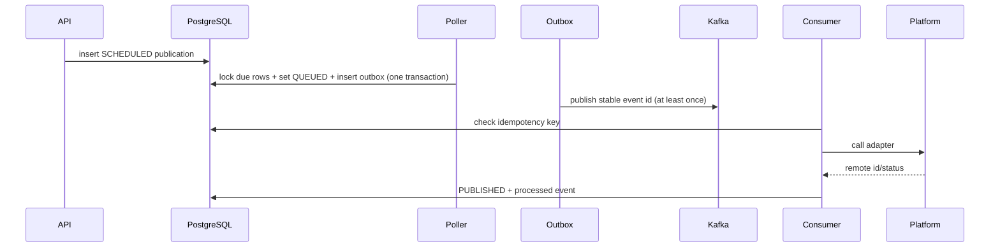

# Social publishing system: architecture and practical lab

## What runs where

The existing `/api/posts` CRUD API remains separate from the scheduled publication API. `ScheduledPublication` is the durable state machine for work that must be published. Kafka carries a small `PublishEvent`; it does not own job state. PostgreSQL stores publications, idempotency records, and outbox events. Local demo adapters print success-shaped results without contacting a social network.



## Beginner theory: scheduling, Kafka, and delivery

`@Scheduled` is a timer that runs on every application instance. Therefore a timer is not a distributed lock. The code uses JPA `PESSIMISTIC_WRITE` row locks inside a short transaction to serialize claimers. A lease timestamp allows expired QUEUED jobs to return to RETRY after a crash. The batch limit prevents an unbounded scan.

The transactional outbox solves the database/Kafka dual-write problem. A normal database commit followed by a Kafka send can fail between the two. Instead, the application commits the state change and outbox record together. The relay sends pending rows and marks them sent. If it crashes after Kafka accepted an event but before that mark commits, the event can appear twice. This is why the consumer uses an event idempotency table.

Kafka delivery and an external HTTP publish cannot form one atomic transaction. If a platform accepts a post and the network drops before the response, the consumer cannot know whether a retry duplicates the post. Real adapters should use a provider idempotency key where supported, reconcile ambiguous responses, and retain the provider remote ID. This demo's DB idempotency prevents duplicate event handling after a successful DB commit, but cannot guarantee exactly-once effects across a third-party API.

## Local run: no paid services or local Kafka install

Requirements: Java 17, Docker Desktop with Compose, and a free port 8080/5432/9092.
If 8080 is busy, set `$env:APP_PORT='8081'` before starting Compose and use port 8081 in the commands below.

```powershell
docker compose up --build
# In another terminal, create a JWT (replace credentials only if you changed the compose defaults)
$token = (Invoke-RestMethod -Method Post http://localhost:8080/api/auth/login -ContentType 'application/json' -Body '{"username":"demo-user","password":"change-me-user"}').accessToken
# Schedule a post for now
$body = @{ platform='LINKEDIN'; content='Hello from the local mock publisher'; scheduledAt=(Get-Date).ToUniversalTime().ToString('o') } | ConvertTo-Json
Invoke-RestMethod -Method Post http://localhost:8080/api/publishing/jobs -Headers @{Authorization="Bearer $token"} -ContentType 'application/json' -Body $body
docker compose logs -f app kafka
```

The response returns a job ID. Query `GET /api/publishing/jobs/{id}` with the same bearer token; expect `PUBLISHED` and a `mock:...` remote ID. Stop with `docker compose down`; `docker compose down -v` removes local database and Kafka data.

## Retry, DLQ, and failure walkthrough

Spring Kafka's `@RetryableTopic` makes four attempts with 1, 2, then 4 second delays (capped at 30 seconds), then routes to `publishing.jobs.DLT`. The retry topic suffixes are created by Spring Kafka. Inspect topics with `docker compose exec kafka /opt/kafka/bin/kafka-topics.sh --bootstrap-server kafka:29092 --list`. Production operators should alert on DLT growth and provide a reviewed replay tool; blindly replaying a terminal event is unsafe.

## Social API adapters and credentials

The default `!real-publishers` profile uses mock adapters. To use a real adapter, activate `real-publishers` and provide secrets via environment or a secret manager. Never commit tokens. LinkedIn's current Posts API uses `POST https://api.linkedin.com/rest/posts`, version and Rest.li headers, and appropriate member/organization permissions. X v2 creates posts at `POST https://api.x.com/2/tweets` and requires approved API access. Instagram publishing is a multi-step media-container flow and requires a professional account, media URL, and permissions; this text-only starter intentionally refuses unsupported payloads instead of claiming success.

Official docs: [LinkedIn Posts API](https://learn.microsoft.com/en-us/linkedin/marketing/community-management/shares/posts-api), [Instagram Content Publishing](https://developers.facebook.com/docs/instagram-platform/instagram-graph-api/content-publishing/), [X create post](https://developer.x.com/en/docs/x-api/tweets/manage-tweets/api-reference/post-tweets). Platform access levels, versions, review requirements, quotas, and rate limits change; confirm current official docs before enabling real publishing. HTTP 429 should be retried after provider `Retry-After`; 4xx validation/auth errors generally need operator correction. An adapter should map provider states such as accepted/processing/published/failed to an explicit status rather than treating HTTP success as final publication.

## Testing and labs

`./mvnw verify` runs JUnit 5 tests. Mockito is included through Spring Boot Test, MockMvc is available for controller tests, Pact JUnit 5 is present for consumer/provider contracts, and Testcontainers JUnit/Kafka dependencies enable isolated integration tests. Testcontainers requires Docker. Useful lab exercises:

1. Write a `PublishingSchedulerTest` with a mocked service; assert one poll requests a bounded batch.
2. Use two transactions/concurrent threads against PostgreSQL Testcontainers; assert each due row is claimed once.
3. Use Kafka Testcontainers to produce the same event twice; assert the publisher runs once after the processed event is committed.
4. Make a mock adapter fail, inspect retry topics, then observe its DLT after attempts are exhausted.
5. Add Pact consumer expectations for `POST /api/publishing/jobs`, then verify provider response/status fields.
6. Add media metadata and implement Instagram's create-container/publish steps with integration tests before enabling its real profile.

Pact checks consumer/provider assumptions across service boundaries; Testcontainers runs real dependencies in disposable containers, giving stronger evidence than mocks. A Mockito unit test isolates one class. MockMvc exercises the HTTP stack without starting a network server.

## CI/CD, canary, and rollback demonstration

GitHub Actions runs Maven `verify`, then builds the container on pushes and pull requests. `workflow_dispatch` runs the same validation as a staging handoff. Configure repository secrets/environment approvals and a real target-specific deploy action before connecting infrastructure; this repository does not assume a cloud vendor or spend money.

Canary lab (Kubernetes example): deploy image `sha A` at 90% traffic, deploy `sha B` at 10%, watch health/error rate/DLT and platform failure metrics for a fixed observation window, then increase traffic in small steps. Rollback by routing all traffic to `sha A` and scaling down `sha B`. Keep database changes backward compatible (expand, migrate, contract); image rollback alone cannot reverse incompatible schema changes. The sample Compose deployment is single instance and is not a production canary environment.

## Troubleshooting / viva questions

- Kafka connection refused: check Kafka health, advertised listener, and use `kafka:29092` from Compose but `localhost:9092` from the host.
- No publish: inspect scheduled time, job state, app logs, and database; the polling batch is bounded to 25.
- Stuck queue: lease recovery runs on the next scheduler poll; review `leaseUntil` and the poller logs.
- DLQ: inspect root exception and credentials/content; fix the cause before replay.
- H2 console is for development only. Compose uses PostgreSQL so row locks and restart durability behave closer to deployment.

Viva: What race does `PESSIMISTIC_WRITE` prevent? Why can an outbox relay deliver twice? What does the consumer idempotency key represent? Why is an external publish not exactly-once? How do retries differ from a DLQ? Why should credentials be injected at runtime? What does a Pact contract protect? When should Testcontainers be preferred to mocks? Why is a canary rollback not enough after a breaking schema migration?
