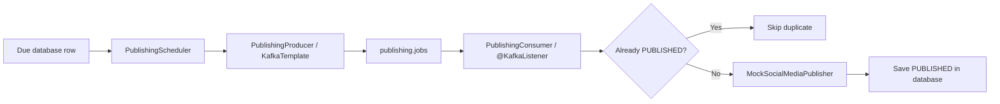

# A message, step by step

This short note follows one publication ticket through Kafka. Read [ARCHITECTURE.md](ARCHITECTURE.md) first for the full beginner guide.

## What does “event-driven” mean?

An event is a note saying that something should happen or has happened. In this project, the note says: “Please publish post number 42.” The scheduler writes this note to Kafka. A listener reads it later. The scheduler does not need to know how the listener works.

That loose connection is useful when the sender and receiver should work independently. It is extra machinery when they do not need that separation.

## The exact note

```json
{"publicationId":42}
```

The event is intentionally small. Kafka transports the note; PostgreSQL stores the full post. This avoids copying the post text into every message and gives the listener one place to look up the current status.

## The route through the code



`KafkaTemplate.send` writes the event. `@KafkaListener` marks the method Spring should call when a record is available. The consumer group name identifies this set of readers; Kafka remembers each group's place with an offset, like a bookmark.

## If the listener fails

The app tries a failed event two more times, one second apart. If it still fails, the recoverer writes it to `publishing.jobs.DLT`. This lets the main stream continue. In this classroom app, students inspect the DLQ manually; there is no replay screen.

The database status check handles the common duplicate case: once the row is `PUBLISHED`, another copy is ignored. It is deliberately a small example rather than a guarantee against every possible crash timing.

## Exercise

Make `MockSocialMediaPublisher.publish` throw an exception. Observe the retry log and the DLT. Restore the mock. Then discuss: should the application automatically replay every old DLQ message? What if the original problem (for example, invalid post text) has not been fixed?
